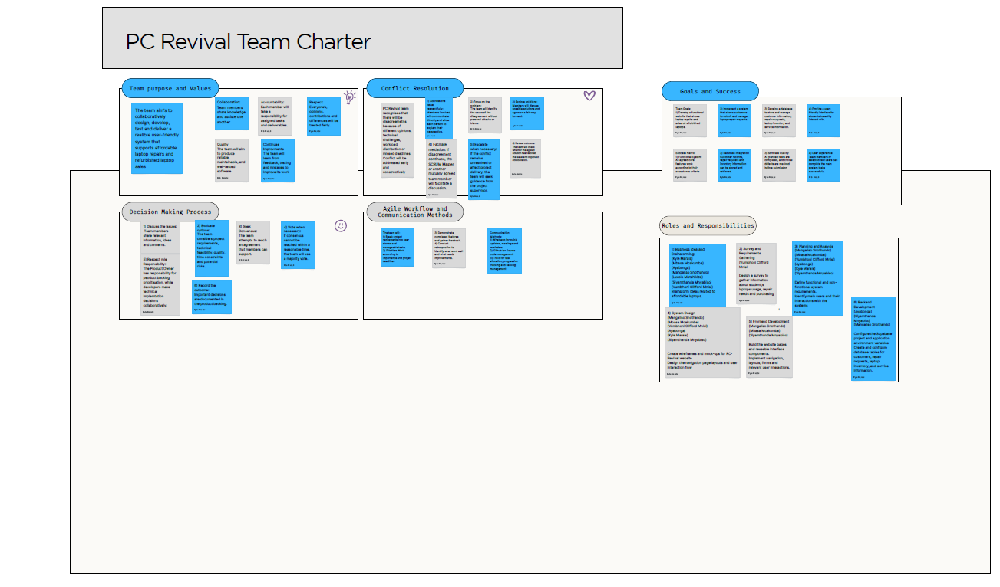

[Home](README.md) | [PC-Revival](PC-Revival.md) | [Team Charter](Team-Charter.md) | [User Stories](User-Stories.md) | [Product Backlog](Product-backlog.md) | [Sprint Backlog](Sprint-backlog.md) | [Agile Logbook](Agile-logbook.md)

## Agile Team Charter
### Purpose of the charter

The Agile Team Charter acts as the team’s shared working agreement.  It defines the project purpose, values, responsibilities, communication methods, decision-making process and procedures for resolving conflict. 

The purpose of the PC Revival team is: 

To collaboratively plan, design, develop, test and present a reliable and user-friendly system that supports affordable laptop repairs, upgrades and refurbished-laptop sales for students. 

The supplied charter already covers team purpose and values, decision-making, conflict resolution, Agile workflow, communication methods, goals, success measures, and roles and responsibilities. 
[Business Team Charter Collaboration.pdf](https://github.com/VumbhoniMnisi/VumbhoniMnisi.github.io/blob/main/Business%20Team%20Charter%20Collaboration.pdf) 
 
### Team values
Collaboration 

All team members share information, knowledge and practical assistance. Tasks are completed collectively instead of allowing one member to struggle without support.

Accountability 

Each member accepts responsibility for assigned work, provides progress updates and raises problems before they affect the project.

Respect

Different ideas and technical opinions are considered fairly. Members challenge an idea or solution without attacking the individual presenting it.

Quality

The team aims to produce work that is reliable, usable, maintainable and tested against agreed requirements.

Integrity

Project information, progress and problems are reported honestly. The team avoids claiming that incomplete work has been completed.

Accessibility

The project remains focused on students and other users who require affordable, practical access to dependable technology.

Sustainability

Where appropriate, usable equipment is repaired, upgraded or refurbished to extend its lifespan and reduce electronic waste.

Continuous improvement

The team uses testing, feedback and retrospectives to identify what worked, what failed and what should change in the next work cycle.

These values combine the working principles in the team charter with the quality, integrity, accessibility, sustainability, innovation and customer commitment values included in the PC Revival presentation.

### Team roles and responsibilities
Team member	Recorded or project responsibilityVumbhoni Clifford Mnisi	Writer/editor; survey and requirements gathering; planning and analysis; system design
Kyle Marais	Team leader; brainstorming; planning and analysis; system design
Luxolo Matshikiza	Researcher; brainstorming
Mbasa Mcakumba	Presenter; brainstorming; planning and analysis; system design; frontend development
Mangaliso Snothando	Designer; brainstorming; planning and analysis; system design; frontend and backend development
Siyamthanda Mnyambiso	Brainstorming; planning and analysis; system design; frontend and backend development
Ayabonga Yawa	Planning and analysis; system design; backend development

The role assignments above reconcile the early group-role document with the more detailed responsibilities recorded in the team charter.

### Communication agreement

The PC Revival team uses:

WhatsApp for quick updates, reminders and meeting arrangements.
Trello for user stories, task allocation, priorities, progress tracking and backlog management.
GitHub for source-code management and version history.
Shared documents for written project material and collaborative editing.
Working agreement
Tasks must have a clear owner.
Members must update task status when work begins or finishes.
Important project decisions must be captured in Trello, GitHub or the project logbook.
Blockers must be reported early.
Code changes must be committed with meaningful messages.
Completed features must be checked against acceptance criteria.
Team feedback must focus on improving the project rather than blaming individuals.
Retrospectives must identify at least one improvement for the next sprint.
### Decision-making process

The team follows this process:

Define the decision or problem.
Allow team members to provide relevant information.
Evaluate the available options against requirements, feasibility, quality, time and potential risks.
Seek consensus.
Use a majority vote when consensus cannot be reached in a reasonable period.
Respect assigned responsibilities. For example, backlog priority is handled through the product-management role, while technical implementation is discussed by the development team.
Record important decisions in the backlog or Agile logbook.
### Conflict-resolution process
Address the issue early and respectfully.
Allow everyone directly involved to explain the situation.
Discuss the problem without personal attacks.
Identify possible solutions.
Agree on a fair and practical way forward.
Use a Scrum Master, team leader or another agreed member as a facilitator if necessary.
Seek guidance from the project supervisor if the issue remains unresolved or threatens delivery.
Review the outcome to determine whether the solution worked.
### Definition of Done

A user story is considered done when:

Its acceptance criteria have been satisfied.
The implementation is connected to the required data or process.
Navigation and interfaces work as intended.
Relevant validation and error handling have been included.
The work has been reviewed or tested.
Critical defects have been resolved.
Evidence has been captured through screenshots, Trello activity, GitHub commits or test results.
The related Trello card has been moved to Done.
### Team Charter evidence

Evidence to display on the GitHub portfolio:

Screenshot of the completed PC Revival Team Charter.
Short caption explaining the charter.
Screenshot of the communication agreement.
Screenshot of the responsibilities section.
Link to or screenshot of Trello.
Screenshot of GitHub collaboration or commit history.
Suggested evidence caption

Figure 1: PC Revival Agile Team Charter. This artefact records the team’s shared purpose, values, working methods, success criteria and responsibilities. It was included because it demonstrates how the group agreed to collaborate and manage project decisions.

### Team Charter reflection

Creating the team charter showed me that Agile teamwork requires more than dividing work among group members. The team needed a shared understanding of the project purpose, communication process, quality expectations and procedure for resolving disagreements. My role included writing and editing project information, gathering requirements, contributing to planning and participating in system design. These responsibilities required me to connect the original business problem with the content and features presented in the project.

The charter also made accountability more visible. When responsibilities were not clearly recorded, it was difficult to determine who should complete or follow up on a task. Recording responsibilities and using Trello provided a clearer basis for tracking the work. I learned that a charter should remain active throughout the project rather than becoming a document that is completed once and forgotten.

If I completed a similar project again, I would finalise the team charter before development begins and attach an owner, acceptance criteria and target sprint to every major task. I would also review the charter during retrospectives so that working agreements could be updated when the team identifies a better way of operating.

